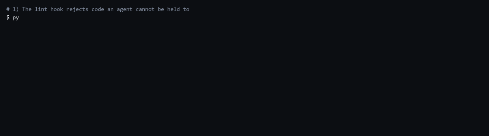

# Red-Sandwich Harness

**Guardrails for AI coding agents that do not take the agent's word for it.**

[](LICENSE)
[](kit/tests)
[](kit)



Coding agents say "done" and "tests pass". Reviewer models cite files that were never
sent and lines that do not exist. Specs leave gaps that both sides argue about forever.
This repository is a small, runnable answer to all three, extracted from a harness that
has driven about 20 real projects since October 2026.

## Quick start (5 minutes, Python 3.10+, no installs)

```bash
git clone https://github.com/jjangkjy5607-dev/red-sandwich-harness
cd red-sandwich-harness

# 1. Lint any Python project: small files, small functions, low complexity, no swallowed errors
python kit/rsh_lint.py check path/to/your/project

# 2. Replay the demo audit offline (no API key)
cd kit
python rsh_audit.py --spec examples/spec_step01.md --files examples/good_unit.py \
                    --response-file examples/auditor_answer.json
```

**Make Claude Code obey the lint on every save** — copy `kit/` into your project and add
[`kit/hooks/settings.example.json`](kit/hooks/settings.example.json) to `.claude/settings.json`.
A failing file returns exit code 2, so the agent sees the findings and must fix them before moving on.

**Audit a real change with a model from another vendor** (any OpenAI-compatible endpoint):

```bash
export RSH_AUDIT_API_KEY=...        # or OPENAI_API_KEY
export RSH_AUDIT_MODEL=<model id>   # pick a different vendor than the model that wrote the code
python kit/rsh_audit.py --spec steps/step01.md --files app.py util.py --rules kit/rules.example.txt
# exit 0 PASS · 1 FAIL · 2 error (an error is never a PASS)
```

## What is in the kit

| File | What it does |
|---|---|
| [`kit/rsh_lint.py`](kit/rsh_lint.py) | AST lint + Claude Code hook. File ≤ 200 lines, function ≤ 35 logic lines, complexity ≤ 5 (also counts `and`/`or` and comprehension loops, so slightly stricter than ruff C901), no bare/silent `except`, no unexplained `sleep`. |
| [`kit/rsh_audit.py`](kit/rsh_audit.py) | Sends the spec and the numbered files to an auditor model and asks for findings as JSON with an exact code quote. |
| [`kit/rsh_evidence.py`](kit/rsh_evidence.py) | Throws out findings whose file was not sent, whose line does not exist, whose quote is not within 3 lines of the cited spot, or whose rule id is unknown. The verdict is recomputed from what survives. |
| [`kit/templates/`](kit/templates) | `overview.md` and `step.md`: spec-first steps with at least three sub-tasks and an **audit-ready limits** section, because auditors attack every unstated limit with the most extreme input they can think of. |

The kit lints itself: `python kit/rsh_lint.py check kit` reports only the deliberately bad example.
Run the tests with `python -m pytest kit/tests`.

## The full harness (not in this repository)

The production harness wraps the same ideas in a runner. Per step:

1. **Spec first.** No step starts without a contract and at least three sub-tasks.
2. **One fresh Claude Code session per step.** The session never starts the next step.
3. **Lint on every save**, and again when the session tries to stop.
4. **Rule audit (GPT)** against numbered rules; invented evidence is discarded by the tool.
5. **The session cannot judge itself.** It writes a test log and an audit request, then exits. A pre-tool hook blocks it from calling the final audit or editing audit records.
6. **The runner audits.** It freezes the git tree, re-runs the rule audit, runs hidden tests and calls the final cross-vendor audit itself.
7. **FAIL → a new session** with higher reasoning effort reads the failure text and the failure rack and patches everything at once. After 5 failed audits, defects that do not block the program are parked as "hard problems" and the pipeline continues.
8. **PASS → commit exactly the audited tree** (`git commit-tree` + compare-and-swap `update-ref`). One changed byte stops the commit.

Every failure is recorded as *trigger · environment · crash point · deterministic guard*, and
later sessions scan that rack before they work.

## Honest limits

- An audit is a sample, not a proof: re-running a passing audit on the same code produced new findings in about 20% of cases in our own comparison (Nov 2026). We are measuring this properly now.
- Lint limits are structural. They keep units reviewable; they do not prove correctness.
- The full harness is built for one Windows PC. The kit is plain Python and runs anywhere.

A paper with controlled experiments (cross-vendor vs same-vendor audit, audit stability,
failure-rack on/off, measured with hidden tests) is in preparation; results will be linked here.

## Background

Design history, incidents that produced each guard, and the Korean write-up:
[turbowork.kr/wiki/harness](https://turbowork.kr/wiki/harness/).
The original 46-line three-layer illustration lives in [`legacy/`](legacy/).

## 한국어 요약

AI 코딩 에이전트의 "다 했습니다"를 믿지 않는 하네스에서 바로 쓸 수 있는 부분만 떼어 낸 키트입니다.
`kit/rsh_lint.py`는 저장할 때마다 파일·함수 크기와 복잡도를 막고(Claude Code 훅), `kit/rsh_audit.py`는
다른 회사 모델에게 검수를 맡기되 보내지 않은 파일·없는 줄·없는 코드를 인용한 지적은 기계적으로 버립니다.
표준 라이브러리만 씁니다.

## License

MIT — see [LICENSE](LICENSE). The production runner and the paid
[Sandwich Workflow Kit](https://turboworkai.gumroad.com/l/sandwich-workflow-kit) are separate and not covered.
