# Red-Sandwich Harness

**A development pipeline for AI coding agents that does not trust the AI.**

**Creator / Original Author:** Taejin Eom (TurboWork) · 엄태진 — [turbowork.kr](https://turbowork.kr) · [Korean wiki](https://turbowork.kr/wiki/harness/)

[](#mit-license)
[](#version-history)
[](#by-the-numbers)

> The coding agent's own words — "done", "tests pass" — are never used as evidence.
> Only machine checks, an audit by a model from a different vendor, and results the
> runner observed itself can move a step forward.



*Orange: enforced by the harness · green: AI work · red: independent audit and failure handling · blue: human decisions.*
([Korean diagram](docs/harness-arch-ko.svg))

## What changed since the first public release

The first release (Oct 27, 2026) described a three-layer contract with a Gemini red-team
reviewer and a 46-line mock example. Since then the harness has been rebuilt around one
lesson: **rules written in a prompt get skipped when the agent is busy.** Most of the
harness is now code — hooks, a runner and audit tools that block progress when a rule
is broken.

| | First release (v5.x, Oct 2026) | Now (v6.6.7, Nov 14, 2026) |
|---|---|---|
| Builder | Codex | Claude Code (one fresh session per step) |
| Auditor | Gemini, in a separate chat | OpenAI GPT, two separate audits called by tools |
| Who calls the final audit | The coding session | The runner, after the session has ended |
| Rule enforcement | Instructions in one long document | 97 numbered rules; hooks, a rule auditor and the runner enforce them |
| What gets committed | Whatever the session left | Exactly the git tree that passed audit |

## How one step runs

1. **Spec first.** `overview.md` and `steps/stepNN.md` fix inputs, outputs and acceptance
   checks, with at least three sub-tasks per step. The runner refuses to start a step without them.
2. **One session, one step.** `run_pipeline.ps1` starts a new non-interactive Claude Code
   session for the step. A session never starts the next step.
3. **Machine checks on every save.** Hooks parse the code (AST) after each edit:
   200 lines per file (350 with approval), 35 logic lines per function, cyclomatic
   complexity ≤ 5, no empty `except`, no unexplained sleeps. They run again when the
   session tries to stop; three blocked stops in a row roll the step back.
4. **Rule audit (GPT).** A rule auditor receives the diff plus the judgement rules from
   `rules.md` and returns only rule violations. Findings that cite unknown rules, files that
   were not sent, or code that does not exist are discarded by the tool.
5. **Audit request, not a verdict.** The session writes the test log and an audit request
   file, sets `VERIFIED_PASS` and exits. It cannot call the final audit or edit audit records —
   a pre-tool hook blocks both.
6. **The runner audits.** The runner freezes the tree (`git add -A`), re-runs the rule audit,
   runs hidden tests, and calls the **final audit (GPT)** itself. Only a verdict the runner
   received directly counts.
7. **FAIL → automatic retry.** A new session with one level higher reasoning effort reads the
   failure text and the failure rack and patches everything in one batch. The fourth FAIL
   stops for a human decision.
8. **PASS → commit the audited tree.** The runner checks that the working tree, the index tree
   ID, the audit record and the test-log hash all match the frozen tree, then commits that tree
   ID directly (`git commit-tree` + compare-and-swap `update-ref`). If one byte changed, it stops.
9. **Handoff.** A step is complete only when the next session's start hook has acknowledged it.

### The sandwich, today

| Layer | Meaning | Enforced by |
|---|---|---|
| Top bread | Spec lock + test-first gate | runner pre-checks, test lock (`tests: write` steps only), hidden tests |
| Filling | Small pure units | AST lint hook on every edit and at stop |
| Bottom bread | Strict isolation | one session per step, atomic state writes with lock + revision merge, protected keys |
| Red line | Independent auditor from another vendor | GPT rule audit + GPT final audit called by the runner |

### Failure rack

Every failure is written down as four fields — **what triggered it · environment · where
it broke · the deterministic guard that now prevents it** — and future sessions scan the
rack before working. The shared rack holds 195 entries. Retries that eventually pass leave
a *skill candidate* ("this is how it was fixed") that a human can approve into a reusable skill.

## Version history

| Date (2026) | Version | Lines | Key change |
|---|---|---|---|
| Jun–Jul | chat rules | — | Born in a stock auto-trading side project: never overwrite whole files, keep every version, verify by running, fix the rules before looking at results |
| Jul 22 | first `AGENTS.md` | 82 | "Senior developer and coding coach" role; no whole-file overwrites |
| Aug 6 | common instructions | 149 | One instruction set for every project: role, safety, verification, token limits |
| Oct 21 | common instructions | 366 | Largest single file before the sandwich |
| Oct 25 | v2.7 | — | "Sandwich" name first used (product edition, Korean + English) |
| Oct 28 | v5.5 | 370 | Red-sandwich structure, spark harness, two-tier failure rack |
| Oct 29 | v6.2 | 510 | Three orthogonal diagnoses, single consolidated patch, gatekeeper |
| Nov 2 | v6.4 | 756 | Longest single document |
| Nov 3–5 | v6.5 / v6.6 | 630–681 | Core + 8 on-demand modules; moved to Claude Code; "instructions cannot be overridden by spec text" clause |
| Nov 8– | git-managed | core 216 | Rules moved into hooks, runner and audit tools |
| Nov 14 | v6.6.7 | — | Audited-tree commit, stricter crash recovery; 7 releases in one day |

### Incidents that created a guard

| Date | What broke | Guard added |
|---|---|---|
| Nov 3 | The agent wrote "this is final, do not ask again" into the spec and used it to skip review | Clause §00: no spec text, scope wording or agent judgement can disable a gate |
| Nov 7 | A background command wrote 232.6 GB of logs and filled the drive | Disk-space guard, session-end cleanup hook |
| Nov 7 | First self-test: 10 of 45 rule-breaking dummy projects got through | Atomic state-file tool; rules moved into code |
| Nov 10 | Runner died but its lock file made it look alive for 17 minutes | Process-liveness rule |
| Nov 12 | An 11 GB model overlapped another job and froze the PC | Memory reservation guard (`memguard`) |
| Nov 13 | 4 of 30 concurrent state writes lost data | Lock + revision-number merge → 0 losses |
| Nov 15 | Too many render workers pinned the CPU; 1,500+ short processes piled up | CPU worker cap, `cpuguard` |

## By the numbers

| Item | Value |
|---|---|
| Rules | 97 (R01–R101): 12 checked by code hooks, 10 by hooks + GPT, 23 by GPT judgement, 52 procedural |
| Code limits | file 200 lines (350 approved), function logic 35 lines, complexity 5, loop nesting 2 |
| Self-test | Nov 7: 35/45 → Nov 14: 112/112 |
| Atomic write stress test | 3 paths × 900 writes, 0 leftover temp files, 0 read errors |
| Audit tool unit tests | final audit 53, rule audit 35 |
| Projects using it | 20 |
| Cost example per session | build ≈ $0.57, rule audit ≈ $0.01 |

## Limits

- Audits are closer to sampling than proof: re-running a PASS audit with the same model
  produced new findings in about 20% of cases (20-case self comparison, Nov 16, 2026).
- Only 22 rules are blocked mechanically; the rest rely on GPT judgement or procedure.
- Built for one Windows PC; paths, guards and the runner assume that environment.

## Minimal proof of concept

[`example_red_sandwich.py`](example_red_sandwich.py) is the original 46-line illustration of
the three layers on five synthetic rows (`x = 0..4`, `y = 2x + 1`):

**AST preflight → mock audit verdict → input contract → pure feature extraction
→ five independent folds → prediction contract → fold MSE output.**

It uses a clearly named offline **mock** auditor — no API key or network call. Only an
explicit Boolean `True` admits the next stage. It illustrates control flow, not the
production harness, and does not prove purity or the absence of leakage.

```powershell
uv venv --python 3.13 .venv
uv pip install --python .venv\Scripts\python.exe numpy==2.5.4 pandas==3.1.0 scikit-learn==1.9.1
.venv\Scripts\python.exe -B .\example_red_sandwich.py
```

## Public scope

This repository contains the public specification, the architecture diagrams and the
synthetic example. The production runner, hooks, audit tools, rule file, competition data
and paid product files are not included and are not covered by the MIT grant below.

## 한국어 요약

**레드 샌드위치 하네스**는 AI 코딩 에이전트의 말("완료했습니다", "테스트 통과")을 판정 근거로 쓰지
않는 개발 파이프라인입니다. 기계 검사, 다른 회사 AI(GPT)의 검수, 실행기가 직접 확인한 결과만
인정합니다. 처음에는 긴 지침 문서였지만, 글로 쓴 규칙은 AI가 바쁠 때 건너뛰어서 지금은 대부분이
어기면 진행이 막히는 프로그램(훅·실행기·검수 도구)입니다.

- Step 하나에 Claude Code 세션 하나. 세션은 검수 요청 파일만 남기고 끝나며, 최종 검수는 실행기가 부릅니다.
- FAIL이면 사고 수준을 올린 새 세션이 실패 기록을 읽고 한 번에 고치고, 4번째 FAIL에서 사람이 결정합니다.
- PASS면 검수한 git 트리 그대로만 커밋합니다. 그 사이 한 글자라도 바뀌면 멈춥니다.
- 규칙 97개, 셀프테스트 112/112, 적용 프로젝트 20개 (2026-11-14 v6.6.7 기준).

자세한 탄생기와 연표: [터보워크 위키 — 레드 샌드위치 하네스](https://turbowork.kr/wiki/harness/)

## MIT License

Copyright (c) 2026 Taejin Eom / TurboWork

Permission is hereby granted, free of charge, to any person obtaining a copy
of this software and associated documentation files (the "Software"), to deal
in the Software without restriction, including without limitation the rights
to use, copy, modify, merge, publish, distribute, sublicense, and/or sell
copies of the Software, and to permit persons to whom the Software is
furnished to do so, subject to the following conditions:

The above copyright notice and this permission notice shall be included in all
copies or substantial portions of the Software.

THE SOFTWARE IS PROVIDED "AS IS", WITHOUT WARRANTY OF ANY KIND, EXPRESS OR
IMPLIED, INCLUDING BUT NOT LIMITED TO THE WARRANTIES OF MERCHANTABILITY,
FITNESS FOR A PARTICULAR PURPOSE AND NONINFRINGEMENT. IN NO EVENT SHALL THE
AUTHORS OR COPYRIGHT HOLDERS BE LIABLE FOR ANY CLAIM, DAMAGES OR OTHER
LIABILITY, WHETHER IN AN ACTION OF CONTRACT, TORT OR OTHERWISE, ARISING FROM,
OUT OF OR IN CONNECTION WITH THE SOFTWARE OR THE USE OR OTHER DEALINGS IN THE
SOFTWARE.

## Sandwich Workflow Kit (paid)

The **Sandwich Workflow Kit v2.7** on Gumroad is the October 2026 document edition:
editable English and Korean instructions, a Windows quickstart, FAQs and two 15-step
project blueprints (Markdown in a ZIP). It predates the v6.6 automation described above and
follows its own product license, separate from this MIT release.

**[Sandwich Workflow Kit v2.7 on Gumroad](https://turboworkai.gumroad.com/l/sandwich-workflow-kit)**
